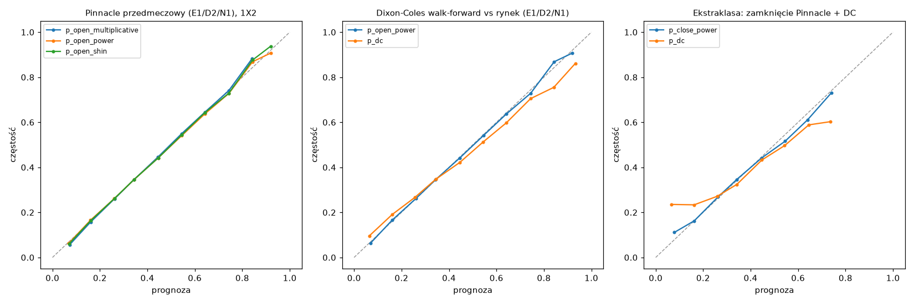

# F2: walk-forward backtest, czyli czy po polskim podatku istnieje przewaga

- **Data:** 2026-10-17
- **Kod:** `src/betting_analyst/backtest/`, uruchomienie `uv run ba-backtest [--refresh]`
- **Pełne tabele (generowane):** [2026-10-f2-backtest-tables.md](2026-10-f2-backtest-tables.md)
- **Decyzja:** [ADR 0022](../adr/0022-wyniki-f2-przewaga-tylko-bez-podatku.md)

## Werdykt w skrócie

**NO-GO dla przewagi po podatku 12% i dla kursów typowego bukmachera. Wąskie, warunkowe GO tylko dla zakładów bez podatku przy kursach z górnej granicy rynku.**

| Pytanie | Odpowiedź |
|---|---|
| Single z podatkiem 12% | **Nie.** Przez 11 sezonów w 3 ligach nie ma żadnej konfiguracji z dodatnim CLV. Nawet po rynkowym Max CLV po podatku wynosi od −4% do −13%. |
| Kursy Avg (typowy bukmacher), nawet bez podatku | **Nie.** Przy progu ≥ 1% nie ma praktycznie żadnych zakładów: średni kurs ma ok. 7% marży wobec fair Pinnacle. |
| Single bez podatku przy rynkowym Max | **Tak, ale optymistycznie.** CLV +2,9% (holdout, n = 190, p_Holm = 0,002), na całości +4,1% (n = 1180). |
| Single bez podatku przy MaxSoft (B365/BW/WH/1XB) | CLV +3,0% na holdoucie, ale n = 47, więc nieistotne po korekcie (p_Holm = 0,58). |
| Ta sama strategia przy 6% podatku (Betclic powyżej limitu) | **Nie.** CLV ≈ −1%. |
| AKO 2 nogi, 0%, Max | CLV +10% przy n = 34 na holdoucie (p_Holm = 0,001, ale poniżej progu n ≥ 100). Na Avg zero kuponów. |
| Kaunitz (konsensus Avg → Max) | **Nie.** CLV od −3% do −14%. |
| Dixon-Coles | **Gorszy od rynku** o ok. 0,023 log loss w każdej lidze i okresie (p < 0,001). Nie daje przewagi ani jako źródło, ani jako filtr. |
| Metoda devig | Różnice nieistotne (Δ log loss < 0,0002, p > 0,4). Zostaje `power`. |

Przewaga istnieje więc tylko na przecięciu dwóch warunków: **brak podatku** (Betclic single do limitu, AKO 0%) **i kurs w odległości ≤ 1–2% od rynkowego maksimum**. Nie wiemy, czy polscy bukmacherzy (Betclic PL) bywają tak blisko Max. To główna niewiadoma i warunek przejścia dalej (F3: kursy PL, potem F6: paper trading).

## 1. Protokół (ustalony przed wynikami)

- **Dane:** football-data.co.uk, E1 / D2 / N1, sezony 2015/16–2025/26 (11 sezonów, 12 022 mecze z Pinnacle przedmeczowym). O/U 2,5 od 2019/20, bo wcześniej brak Pinnacle O/U. Ekstraklasa: 2015/16–2025/26 tylko z kursami zamknięcia (sekcja 6). W 2025/26 Pinnacle zniknął z plików w trakcie sezonu, stąd mniejsze N.
- **Chwila decyzji = moment zbierania kursów przez football-data** (zwykle piątek po południu dla weekendu, wtorek dla środka tygodnia). Prawdopodobieństwo fair to devig PSH/PSD/PSA (i P>2.5). Kurs zagrania pochodzi z tego samego momentu: Avg (realistyczny), MaxSoft = max(B365, BW, WH, 1XB) (pośredni), Max rynkowy (optymistyczny; przed 2019/20 Betbrain BbMx). **Zamknięcie PSCH/PSCD/PSCA służy wyłącznie do CLV** i jest dołączane po wyborze zakładu (test `test_strategy_selection_ignores_closing_odds`).
- **CLV** = `kurs_po_podatku × p_fair_zamknięcia − 1`, devig zamknięcia tą samą metodą (power). t-test jednostronny liczony na średnich per mecz, bo zakłady 1X2 i O/U z jednego meczu są skorelowane.
- **Strategie** (wspólna warstwa `decision/ev.py`): A single 12%; B single 0% (w symulacji bankrolla miesięczny limit Betclic 1000 zł, potem 6%); C2/C3 AKO 2/3 nogi 0% (`build_ako_proposals`, jedno AKO dziennie, nogi z różnych meczów); D Kaunitz (p = zdewigowany konsensus Avg, zagranie po MaxSoft/Max); E1 value wg Dixon-Colesa; E2 rynek + filtr zgodności z DC (|Δp| ≤ 8 pp). Na każdy mecz i rynek najwyżej jeden zakład (najwyższe EV). Progi EV: 0, 1, 2, 3, 5, 7, 10% i reguła ADR 0014 (3%, a przy kursie > 3,0 5%). Razem 192 konfiguracje.
- **Dixon-Coles walk-forward:** refit co tydzień (bloki pt–czw), trening tylko na meczach z datą < początek bloku, okno 3 lata, ξ = 0,0018 (`strategy.yaml`), rozgrzewka 2012–2015. Pokrycie ok. 99% meczów (beniaminkowie bez historii są pomijani). Testy: `test_model_for_day_d_never_sees_matches_on_or_after_d`, `test_future_results_do_not_change_prediction`.
- **Podział:** dev = 2015/16–2021/22 (wybór metody devig i progu), holdout = 2022/23–2025/26.
  - **Test główny:** dla każdej pary (strategia × wariant kursu) wybieramy na dev próg o najwyższym średnim CLV przy n ≥ 100. Na holdoucie wykonujemy jeden test, a p-wartości korygujemy metodą Holma.
  - **Test wtórny, bez strojenia:** progi ADR 0014, ustalone przed F2, sprawdzane bezpośrednio na holdoucie, z korektą Holma.
- **Kryterium GO:** co najmniej jedna strategia na Avg lub MaxSoft ma na holdoucie CLV > 0 przy p_Holm < 0,05 i n ≥ 100. Wynik spełniony tylko na Max oznacza warunkowe GO, zależne od kursów PL.

Uwaga: w planie dev kończył się na 2022/23. Po pobraniu danych okazało się, że Pinnacle 1X2 jest dostępny od 2015/16, więc dev wydłużyłem do 2015/16–2021/22. Zmiana nastąpiła przed jakimkolwiek wynikiem strategii.

## 2. Kalibracja metod devig (Pinnacle przedmeczowy, E1/D2/N1)

| rynek | okres | n | multiplicative LL | power LL | shin LL | RPS (power) |
|---|---|---|---|---|---|---|
| 1X2 | dev | 8039 | 1,0160 | 1,0160 | 1,0160 | 0,2085 |
| 1X2 | holdout | 3983 | 1,0067 | 1,0066 | 1,0065 | 0,2073 |
| O/U 2,5 | dev | 3405 | 0,6772 | 0,6771 | 0,6772 | — |
| O/U 2,5 | holdout | 3983 | 0,6744 | 0,6742 | 0,6743 | — |

- Sparowane różnice log loss między metodami są rzędu 10⁻⁵, p od 0,47 do 0,95. **Przy marży Pinnacle ok. 2–3% wybór metody nie ma znaczenia.** Na dev minimalnie wygrał `power`, więc zostaje domyślny (bez zmian w `strategy.yaml`). To samo widać na zamknięciach i w Ekstraklasie.
- Krzywe kalibracji ([img/f2-calibration.png](img/f2-calibration.png)) leżą na przekątnej. Lekkie odchylenia dla faworytów > 0,85 wynikają z małych binów.

## 3. Dixon-Coles vs rynek

| liga | 1X2 LL rynek | 1X2 LL DC | Δ (DC − rynek) | O/U Δ |
|---|---|---|---|---|
| Championship | 1,0343 | 1,0568 | +0,0225 | +0,0141 |
| 2. Bundesliga | 1,0506 | 1,0765 | +0,0259 | +0,0185 |
| Eredivisie | 0,9349 | 0,9564 | +0,0215 | +0,0135 |
| Ekstraklasa (vs zamknięcie) | 1,0379 | 1,0726 | +0,0347 | — |

DC jest istotnie gorszy od rynku w każdej lidze, okresie i rynku (p < 0,01, poza Eredivisie O/U na dev: p = 0,08). Jest też zbyt pewny na krańcach (wykres). Strategia E1 (value wg DC) daje CLV od −5% do −19%. Filtr E2 tylko zmniejsza liczbę zakładów i nie poprawia CLV. **Zgodnie z ADR 0011 („każda warstwa musi pobić poprzednią”) DC nie wchodzi do decyzji.** Zostaje najwyżej flagą „do ręcznej weryfikacji”.

## 4. Strategie: wyniki

Sanity, czyli granie wszystkiego (CLV przed podatkiem): po PSH −3,8%, po Avg −6,8%, po MaxSoft −4,4%, po Max −1,5%. Z 12% podatkiem wychodzi od −13% do −18%. **Typowy bukmacher (Avg) ma ok. 7% „marży” wobec fair**, a po podatku trzeba pobić fair o ok. 14%.

### Test główny (próg strojony na dev → holdout, Holm)

| strategia | kurs | próg (dev) | dev n / CLV | holdout n / CLV | % bije zamkn. | p_Holm | GO? |
|---|---|---|---|---|---|---|---|
| A single 12% | Avg, MaxSoft | — | 0 (żaden próg nie daje n ≥ 100) | — | — | — | ✗ |
| B single 0% | Avg | — | 0 | — | — | — | ✗ |
| B single 0% | MaxSoft | 5% | 107 / +4,4% | 37 / +2,7% | 68% | 1,00 | ✗ |
| C2 AKO 0% | MaxSoft | 2% | 133 / +3,8% | 29 / −1,5% | 45% | 1,00 | ✗ |
| C3 AKO 0% | MaxSoft | 1% | 150 / +4,3% | 28 / +1,5% | 54% | 1,00 | ✗ |
| D Kaunitz 0% | MaxSoft | 10% | 176 / −1,0% | 25 / 0,0% | 52% | 1,00 | ✗ |
| E2 rynek+DC 0% | MaxSoft | ADR | 119 / +3,6% | 43 / +2,9% | 74% | 0,84 | ✗ |
| *B single 0%* | *Max* | *7%* | *200 / +6,0%* | *69 / +3,6%* | *59%* | *0,15* | ✗ |
| *C2 AKO 0%* | *Max* | *ADR* | *246 / +9,2%* | *34 / +10,2%* | *74%* | *0,001* | ✗ (n < 100) |

Strategie A, D z podatkiem i E1 we wszystkich wariantach mają ujemne CLV i nie wchodzą do tabeli (szczegóły w pliku tabel).

**Wynik testu głównego: NO-GO we wszystkich wariantach, także optymistycznym.** Protokół wybierający próg po najwyższym średnim CLV promuje wysokie progi z małym N na holdoucie. To słabość protokołu, którą odnotowuję, ale nie zmieniam go po fakcie.

### Test wtórny (progi ADR 0014, bez strojenia)

| strategia | kurs | holdout n | CLV | % bije | ROI (płaska stawka) | p | p_Holm | GO? |
|---|---|---|---|---|---|---|---|---|
| B single 0% | MaxSoft | 47 | +3,0% | 72% | −17% | 0,032 | 0,58 | ✗ |
| E2 rynek+DC 0% | MaxSoft | 43 | +2,9% | 74% | −9% | 0,047 | 0,79 | ✗ |
| **B single 0%** | **Max** | **190** | **+2,9%** | **67%** | −5% [−30%; +24%] | 0,0004 | **0,002** | **✓ (tylko Max)** |
| C2 AKO 0% | Max | 34 | +10,2% | 74% | −14% | 0,0002 | 0,001 | ✗ (n < 100) |
| A single 12% | dowolny | 0–1 | — | — | — | — | — | ✗ |

Na całych 11 sezonach B / Max / ADR: n = 1180, CLV +4,1%, 73% zakładów bije zamknięcie, ROI +2,6% [−5,6%; +11,9%]. ¼ Kelly z capem 1,5% daje 1000 → 1668 zł przy maks. obsunięciu 13%. Limit Betclic 1000 zł/mies. przy bankrollu 1000 zł nigdy nie zadziałał (ok. 9 zakładów miesięcznie po ≤ 15 zł).

### Wrażliwość: jak blisko Max musi być polski bukmacher

Kurs = Max × (1 − h), single, próg ADR:

| h | podatek 0%: holdout n / CLV / p | podatek 0%: całość n / CLV | podatek 6%: całość n / CLV | podatek 12%: całość n / CLV |
|---|---|---|---|---|
| 0% | 190 / +2,9% / 0,0004 | 1180 / +4,1% | 79 / +0,8% | 14 / −4,5% |
| 1% | 108 / +2,5% / 0,023 | 630 / +3,8% | 58 / −1,3% | 11 / −1,1% |
| 2% | 75 / +1,7% / 0,17 | 373 / +3,6% | 40 / −2,6% | 9 / −1,8% |
| 3% | 53 / +1,4% / 0,27 | 247 / +2,9% | 31 / −3,6% | 5 / — |
| 5% | 32 / +2,1% / 0,25 | 110 / +3,0% | 22 / −6,1% | 3 / — |

Wnioski:
- Każdy procent poniżej Max mniej więcej połowi liczbę okazji. Przy h ≥ 2% na holdoucie zostaje < 1 zakład tygodniowo na 3 ligi, bez istotności.
- 6% podatku wystarczy, żeby zjeść przewagę. 12% wyklucza ją całkowicie.

### Trend w czasie

B / Max / ADR, CLV i liczba zakładów per sezon:

| | 15/16 | 16/17 | 17/18 | 18/19 | 19/20 | 20/21 | 21/22 | 22/23 | 23/24 | 24/25 | 25/26* |
|---|---|---|---|---|---|---|---|---|---|---|---|
| n | 126 | 179 | 162 | 117 | 158 | 116 | 132 | 62 | 57 | 48 | 23 |
| CLV | +3,6% | +3,9% | +5,6% | +5,4% | +3,9% | +4,1% | +3,9% | +4,1% | +2,7% | +2,4% | +1,4% |

\* Pinnacle tylko do połowy sezonu.

Od 2022/23 okazji jest 2–3 razy mniej, a CLV maleje. Rynek się wyrównuje, więc wynik całości (+4,1%) przeszacowuje to, co jest dostępne dziś.

## 5. Dlaczego ROI ≠ CLV

ROI na holdoucie jest ujemne przy dodatnim CLV, a 95% CI ROI ma szerokość ok. 50 pp. Przy ok. 50 zakładach rocznie i średnim kursie ok. 4–6 ROI to w praktyce szum (ADR 0001, 0015). Dlatego werdykt opiera się na CLV.

## 6. Ekstraklasa (tylko kursy zamknięcia, to NIE jest backtest decyzyjny)

POL.csv nie ma kursów przedmeczowych, więc nie da się zmierzyć CLV ani zagrać „w chwili decyzji”. Zrobiłem dwie rzeczy:
- **Kalibracja** devig zamknięcia Pinnacle: metody nierozróżnialne (LL 1,0377–1,0379). DC gorszy od zamknięcia o 0,035 LL, najwięcej spośród lig.
- **Zakład w chwili zamknięcia** (Avg/Max zamknięcia vs fair zamknięcia Pinnacle z tej samej chwili; tu CLV ≡ EV):

| | Avg zamkn., 12% | Avg zamkn., 0% | Max zamkn., 12% | Max zamkn., 0% |
|---|---|---|---|---|
| średnie EV wszystkich selekcji | −18,6% | −7,5% | −12,8% | −0,9% |
| odsetek selekcji z EV ≥ 0 | 0,01% | 0,46% | 0,65% | 32,8% |
| ROI zakładów z EV ≥ 3% (n) | — (0) | −18% (10) | −30% (28) | −2,0% [−11%; +7%] (1001) |

Dla porównania E1/D2/N1 przy Max zamknięcia i 0%, EV ≥ 3% dają ROI od +5% do +7% (n = 592–933, CI obejmują 0). W Ekstraklasie ROI wynosi ok. −2%. **Brak przesłanek, że Ekstraklasa jest bardziej „miękka”.** Kalibracja rynku jest tu podobna jak w pozostałych ligach, a model statystyczny radzi sobie najgorzej. Do czasu zebrania własnych snapshotów kursów przedmeczowych Ekstraklasa nie ma żadnego dowodu przewagi.

## 7. Wiarygodność i ograniczenia

- **Max to nie polski bukmacher.** Rynkowy Max football-data (oddsportal; przed 2019/20 Betbrain) to maksimum z kilkudziesięciu buków, w tym międzynarodowych, bez gwarancji, że oferta była dostępna dla gracza z PL i nie zostałaby anulowana jako „palpable error”. Wykluczenie zakładów z Max/PSH > 1,25 (outliery) nie zmienia wyniku (CLV +4,3%). Przewaga przy Max jest jednak górną granicą, nie oczekiwaną wartością.
- **Chwila decyzji jest przybliżona.** Football-data nie podaje znacznika czasu kursów przedmeczowych. Kursy Avg/Max i PSH pochodzą z tego samego zrzutu, ale realny gracz mógł widzieć inne ceny.
- **Wielokrotne porównania:** 192 konfiguracje. Korekta Holma działa w obrębie każdego testu (główny: 18 + 6 par, wtórny: 18 + 6), a nie na całej siatce. Pełna siatka jest opisowa.
- **Holdout jest mały:** 3,5 sezonu, a 2025/26 częściowy. Dla wariantów MaxSoft i AKO N < 100.
- **AKO po Max** zakłada, że każda noga jest u innego buka, co dla AKO jest nierealne. Wynik AKO/Max to wyłącznie górna granica.
- **Podatek od wygranej 10% (> 2280 zł)** pominięty, bo przy stawkach ≤ 15 zł nie występuje.
- **Ocena wiarygodności:** NO-GO dla podatku 12% i kursów Avg jest **bardzo wiarygodne**: zero okazji w 11 sezonach, margines kilkunastu punktów procentowych. Warunkowe GO przy 0% i Max jest **umiarkowanie wiarygodne jako górna granica** (istotne w teście wtórnym, nieistotne w głównym), ale **nieprzenoszalne wprost** na polskich bukmacherów bez danych o ich kursach.

## 8. Co dalej

1. **F3: kursy Betclic PL (i STS, Fortuna, Superbet) jako snapshoty z czasem.** Kluczowa metryka to rozkład `kurs_PL / max_rynkowy` oraz odsetek selekcji, w których Betclic jest ≤ 1–2% od Max. Bez tego nie ma podstaw do F6.
2. Skaner (`scan.py`): kandydaci z podatkiem 12% praktycznie nie wystąpią. Raport dzienny powinien wprost pokazywać tylko ścieżki 0% (Betclic single do limitu, AKO 0%), a shadow bets dalej mierzyć CLV.
3. Dixon-Coles, Elo i stacking (ADR 0011, etapy 3–4) zawieszone jako źródło przewagi.
4. Kryterium F6 bez zmian (≥ 300 zakładów, CLV > 0, p < 0,05), ale tylko dla zakładów 0% po realnych kursach PL.

## 9. Audyt (backtest-auditor)

Patrz sekcja „Audyt” poniżej, uzupełniona po przeglądzie.
